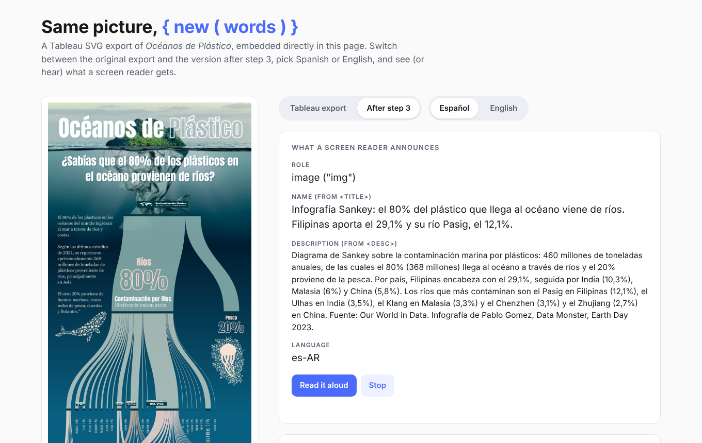
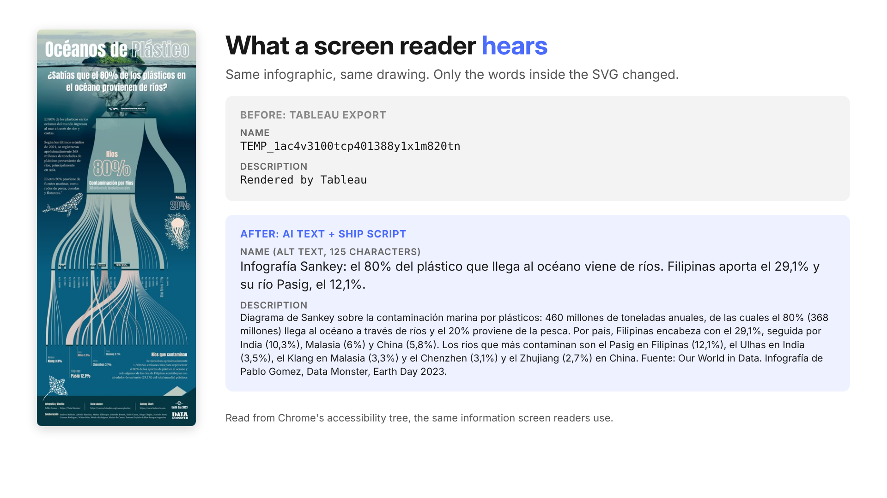
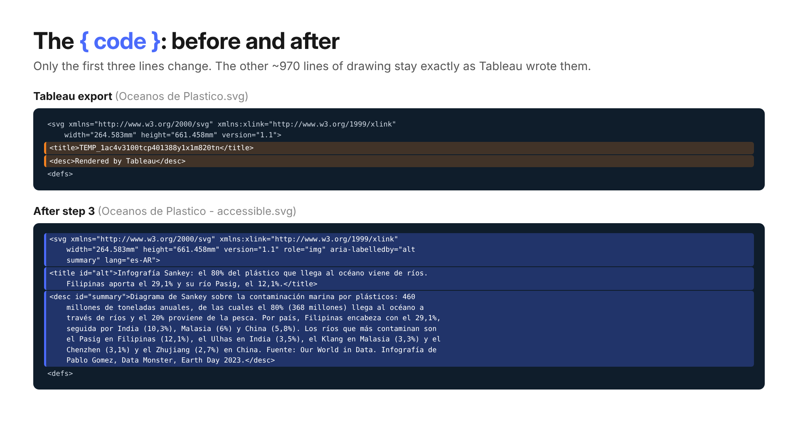

# DDQ2026-10: Image Exports

### A picture is worth a thousand words. We only need 150.

| | |
|---|---|
| **Code** | `#DDQ2026-10` |
| **Levels** | Beginner, Intermediate, Bonus |
| **Tools** | REST API or Tableau Server Client (TSC), Tableau MCP (optional), any AI model that can read images |
| **Presented** | DataDev Tableau User Group, October 2026 |
| **Solution** | Walked through at the November 2026 TUG and added to this folder |
| **Author** | [Pablo Gomez](https://www.linkedin.com/in/pablolgomez) |

**[Open the live demo](https://pablodatamonster.github.io/datadevquest-challenges/DDQ2026-10-image-export/demo/)** to see what a finished result looks like: switch between the original Tableau export and the accessible version, change the language, and hear what a screen reader reads.

---

## One dashboard, two files

Tableau can export the same view as a PNG or an SVG. They look the same, but they are very different files.

| PNG | SVG |
|---|---|
| Pixels: a grid of coloured dots | Code: XML text you can open in any editor |
| Blurs when you zoom in | Sharp at any size |
| You can look at it, not edit it | You can search it, edit it and add to it |
| Best for AI models that read images, email and Slack | Best for web pages, print and accessibility |

Try it: open both files from the [`sample`](sample/) folder in a text editor.

## What's new

SVG export now works through the API, not only in Tableau Desktop.

**REST API**
- The [Query View Image](https://help.tableau.com/current/api/rest_api/en-us/REST/rest_api_ref_workbooks_and_views.htm) endpoint accepts `format=SVG`:
  `GET /api/<api-version>/sites/<site-id>/views/<view-id>/image?format=SVG`
- SVG needs Tableau Server 2026.2 or later (REST API 3.29 or later). PNG is still the default and works on every version.
- Filter the image with `vf_<field>=<value>`, for example `?vf_Region=West`.
- [Tableau Server Client](https://tableau.github.io/server-client-python/) is adding the same option through `ImageRequestOptions`. Check your version; if it isn't there yet, a plain `requests` call works.

**Tableau MCP**
- The [`get-view-image`](https://tableau.github.io/tableau-mcp/docs/tools/views/get-view-image) tool returns PNG or SVG.
- Its documentation recommends PNG when the image will be analysed, and SVG when it will be shown to people. That advice is the design of this challenge.

## Why it matters

**Screen readers cannot read pixels.**

- A dashboard shared as an image is silent to a screen reader.
- Alt text is usually missing, or just says "dashboard".
- Nobody writes it by hand for 50 views.

**The fix:**

- AI drafts the description from the PNG.
- The SVG carries the text, so it travels with the image.
- A person checks it before it ships.

## The challenge

| 1. Export | 2. Describe | 3. Ship |
|---|---|---|
| Download the same view twice from the REST API: once as PNG, once as SVG. | Send the PNG to an AI that can read images. Ask for alt text (150 characters max) and a short summary. | Write the text into the SVG as `<title>` and `<desc>`, by hand or with code. Screen readers read it aloud. |

**The PNG goes to the AI. The SVG goes to the people.**

## Your quest

Pick your level. Every level starts with the same dashboard.

### Beginner
- Export one view as PNG and SVG
- Ask an AI to describe the PNG
- Print the alt text and summary

### Intermediate
- All three steps: Export, Describe, Ship
- Loop over a filter so each region gets its own accessible SVG

### Bonus: make it reusable
- Package the process so anyone can run it
- Build a Claude Skill, a Gemini Gem, a Custom GPT or your own app

## What a finished result looks like

What a screen reader announces before and after, for the sample infographic. These values were read from Chrome's accessibility tree, which is what screen readers use.

The only lines that change in the SVG. The other ~970 lines of drawing stay exactly as Tableau wrote them.

## Get started

**You need**
- A Tableau Cloud or Server 2026.2+ site (free with the [Developer Program](https://developer.tableau.com))
- A Personal Access Token
- Python with `tableauserverclient` or `requests`
- An AI that can read images: Claude, Gemini, ChatGPT or a local model
- A sample workbook such as Superstore

**No site handy?** Start at step 2 with the files in [`sample`](sample/): an infographic exported from Tableau as [PNG](sample/oceanos-de-plastico.png) and [SVG](sample/oceanos-de-plastico.svg).

**On an older Server?** PNG export works for steps 1 and 2. For step 3, export the SVG from Tableau Desktop and start there.

## Tips

- **Look at the top of the SVG.** Tableau already writes a `<title>` and a `<desc>`, but they are placeholders.
- **Ask the AI for JSON** (for example `{"alt": "...", "summary": "..."}`) so your code can read the answer.
- **Use AI for the words, code for the edit.** Tableau SVGs are large; an AI rewriting the whole file may change or cut parts of the drawing.
- **Mind the language.** Write the text in the infographic's language and set `lang` on the `<svg>` tag so screen readers pick the right voice.
- **`` tags ignore the title inside an SVG.** The text works when the SVG is placed inside the page (inline) or opened on its own. If you embed it with ``, also add `alt="..."` to the tag.
- **Use sample data.** For real dashboards, follow your organisation's AI policy before sending images to an external model.

## Share it

- Post your solution in `#datadev-quest-challenges` on the [Tableau #DataDev Slack](https://tableau-datadev.slack.com)
- Challenge details at [datadevquest.com](https://datadevquest.com)
- One possible solution will be walked through at the November 2026 TUG and added here

## Credits

Sample infographic: *Océanos de Plástico* by Pablo Gomez, [Data Monster](https://data.monster), Earth Day 2023. Data source: [Our World in Data](https://ourworldindata.org/ocean-plastics).

[Back to all challenges](../README.md)
