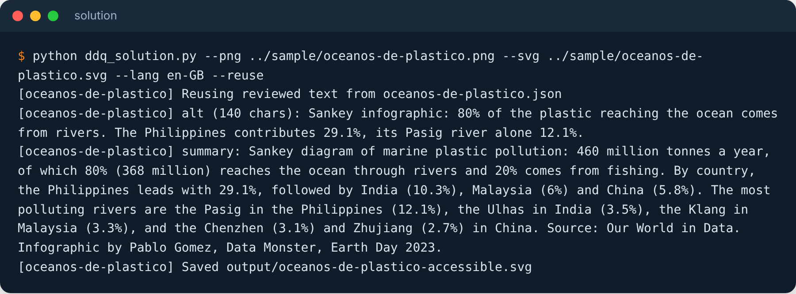
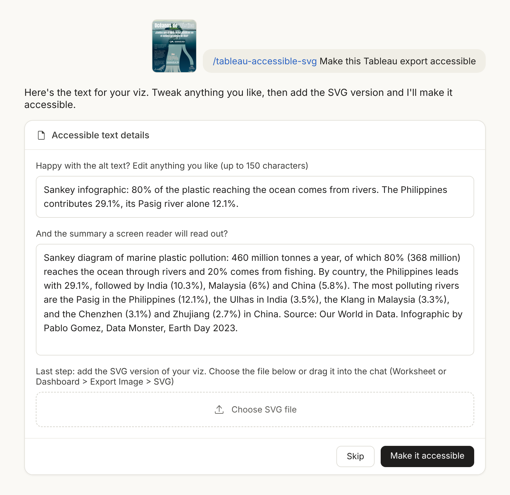

# DDQ2026-10 solution: Image Exports

One possible solution to [DDQ2026-10](../README.md). There is never only one right answer: every approach that works is welcome.

**No code?** Use the Claude Skill: download it, add it to Claude and attach your PNG. [Jump to the Skill](#bonus-the-claude-skill).

<a href="https://github.com/pablodatamonster/datadevquest-challenges/raw/main/DDQ2026-10-image-export/solution/skill/tableau-accessible-svg.zip"></a>

| | |
|---|---|
| **Script** | [`ddq_solution.py`](ddq_solution.py): Export, Describe, Ship and Repeat in one Python file |
| **AI** | Claude, through the [Anthropic Python SDK](https://platform.claude.com/docs/en/build-with-claude/vision) |
| **Bonus** | [`skill/`](skill/): the same process as a Claude Skill, no code or API key needed |
| **Examples** | [`examples/`](examples/): the sample infographic made accessible in Spanish and English |

## The idea in one line

**The PNG goes to the AI. The SVG goes to the people.** Tableau draws every letter in an SVG as a shape, so there is no readable text in it for an AI. The PNG is what the AI reads; the SVG is what people see, so that is where the description goes.

What a screen reader hears, before and after. Only the words inside the SVG changed:


## How the script works

```
1. EXPORT    REST API: sign in with a PAT, find the view, GET .../views/{id}/image (PNG) and ?format=SVG
2. DESCRIBE  send the PNG to Claude, ask for {"alt": ..., "summary": ...} as JSON
3. SHIP      replace Tableau's placeholder <title>/<desc>, add role, aria-labelledby and lang
4. REPEAT    one export per filter value: ?vf_Region=West, ?vf_Region=East, ...
```

Each step is one small function in the script: `Tableau.view_image()`, `describe()` and `ship()`.

## Run it

```bash
pip install -r requirements.txt
cp .env.example .env        # then add your Tableau PAT and Claude API key
```

**Live, against your Tableau site** (Tableau Server 2026.2+ or Tableau Cloud, REST API 3.29+):

```bash
python ddq_solution.py --view "Overview" --workbook "Superstore" --filter Region=Central,East,South,West
```

**No site? Start from the sample files** (step 2 onwards):

```bash
python ddq_solution.py --png ../sample/oceanos-de-plastico.png --svg ../sample/oceanos-de-plastico.svg --lang es-AR
```

Here is a real run on the sample files, using the reviewed text with `--reuse`:



Results go to `output/`: for each view (or filter value) you get the PNG, the original SVG, the AI text as JSON and `<name>-accessible.svg`.

## Human in the loop

The AI drafts; a person checks. The script prints the alt text and summary and saves them as `<name>.json`. If a number is wrong, edit the JSON and run the same command again with `--reuse`: it ships your corrected text without calling the AI again.

## Decisions worth knowing

- **AI for the words, code for the edit.** The script never lets the AI touch the SVG. Tableau SVGs are large, and an AI rewriting one may change or cut parts of the drawing. Only the first three lines of the file change; the drawing is byte-for-byte the same.
- **Replace, don't add.** Tableau already writes `<title>TEMP_...</title>` and `<desc>Rendered by Tableau</desc>`. The script replaces those, so screen readers don't announce the placeholder.

  

- **`lang` matters.** It tells the screen reader which voice to use. Ask for the text in the language of the visualisation (`--lang es-AR`), or another one if your readers need it.
- **The filter goes into the prompt.** When looping over Regions, the AI is told which Region it is looking at, so the description says so.
- **`` tags ignore the title inside an SVG.** If you embed the result with ``, also add `alt="..."` to the tag. Inline SVG, or opening the file on its own, works as is.

## Bonus: the Claude Skill

[`skill/tableau-accessible-svg`](skill/tableau-accessible-svg/) packages the whole process so anyone can run it by asking Claude. No code and no API key: Claude reads the PNG itself and a small script, [`ship_svg.py`](skill/tableau-accessible-svg/scripts/ship_svg.py), writes the text into the SVG.

<a href="https://github.com/pablodatamonster/datadevquest-challenges/raw/main/DDQ2026-10-image-export/solution/skill/tableau-accessible-svg.zip"></a>

**1. Install it (once)**

- Download [`tableau-accessible-svg.zip`](https://github.com/pablodatamonster/datadevquest-challenges/raw/main/DDQ2026-10-image-export/solution/skill/tableau-accessible-svg.zip).
- In Claude, go to **Settings > Capabilities > Skills** and upload the zip.
- Using Claude Code? Copy the `tableau-accessible-svg` folder into `.claude/skills/` instead.

**2. Use it**

- Export your view from Tableau as PNG and SVG (Worksheet or Dashboard > Export Image).
- Start a chat, attach the PNG and type: *"Make this Tableau export accessible"*.
- Claude writes the alt text and the summary and shows them in a small form. Change any words you like right there, then add your SVG: choose the file in the form or drag it into the chat.
- Press **Make it accessible**. Claude sends back your accessible SVG.



The Skill describes the chart exactly as it is. It doesn't review or fact-check your data: that's a different job. It can also get the images for you through Tableau MCP's `get-view-image` tool or the REST API.

## Credits

Solution by [Pablo Gomez](https://www.linkedin.com/in/pablolgomez/), built with Claude. Sample infographic: *Océanos de Plástico*, Data Monster, Earth Day 2023. Data: [Our World in Data](https://ourworldindata.org/ocean-plastics).
