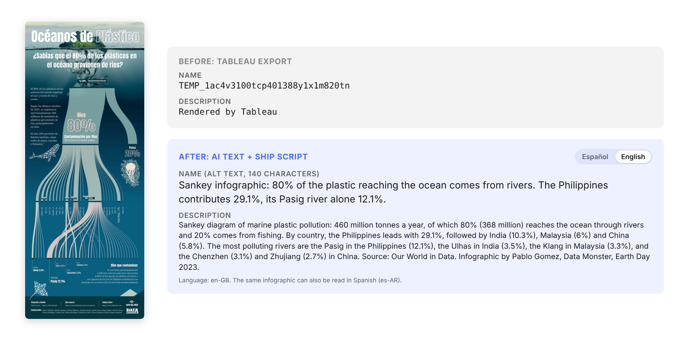
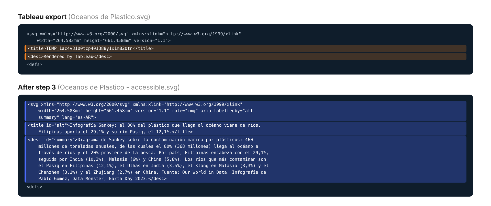

# DDQ2026-10 solution: Image Exports

One possible solution to [DDQ2026-10](../README.md). There is never only one right answer: every approach that works is welcome.

| Level | Solution | You need |
|---|---|---|
| **Beginner** | [The Claude Skill](#beginner-the-claude-skill): ask Claude, get an accessible SVG back | Claude and your PNG and SVG. No code |
| **Intermediate** | [The Python script](#intermediate-the-python-script): Export, Describe, Ship and Repeat in one file | Python, a Claude API key and (for the live export) a Tableau PAT |

Both are shown with the sample infographic in [`examples/`](examples/), made accessible in Spanish and English.

## The idea in one line

**The PNG goes to the AI. The SVG goes to the people.** Tableau draws every letter in an SVG as a shape, so there is no readable text in it for an AI. The PNG is what the AI reads; the SVG is what people see, so that is where the description goes.

What a screen reader hears, before and after. Only the words inside the SVG changed:



---

## Beginner: the Claude Skill

[`skill/tableau-accessible-svg`](skill/tableau-accessible-svg/) packages the whole process so anyone can run it by asking Claude. No code and no API key: Claude reads the PNG itself and a small script, [`ship_svg.py`](skill/tableau-accessible-svg/scripts/ship_svg.py), writes the text into the SVG.

<a href="https://github.com/pablodatamonster/datadevquest-challenges/raw/main/DDQ2026-10-image-export/solution/skill/tableau-accessible-svg.zip"></a>

**1. Install it (once)**

- Download [`tableau-accessible-svg.zip`](https://github.com/pablodatamonster/datadevquest-challenges/raw/main/DDQ2026-10-image-export/solution/skill/tableau-accessible-svg.zip).
- In Claude, go to **Settings > Capabilities > Skills** and upload the zip.
- Using Claude Code? Copy the `tableau-accessible-svg` folder into `.claude/skills/` instead.

**2. Use it**

- Export your view from Tableau as PNG and SVG (Worksheet or Dashboard > Export Image).
- Start a chat, attach the PNG and type: *"Make this Tableau export accessible"*.
- Claude writes the alt text and the summary and shows them in a small form. Change any words you like right there, then add your SVG: choose the file in the form or drag it into the chat.
- Press **Make it accessible**. Claude sends back your accessible SVG.


The Skill describes the chart exactly as it is. It doesn't review or fact-check your data: that's a different job. It can also get the images for you through Tableau MCP's `get-view-image` tool or the REST API.

---

## Intermediate: the Python script

[`ddq_solution.py`](ddq_solution.py) does the four steps in one Python file, with Claude as the AI (through the [Anthropic Python SDK](https://platform.claude.com/docs/en/build-with-claude/vision)):

```
1. EXPORT    REST API: sign in with a PAT, find the view, GET .../views/{id}/image (PNG) and ?format=SVG
2. DESCRIBE  send the PNG to Claude, ask for {"alt": ..., "summary": ...} as JSON
3. SHIP      replace Tableau's placeholder <title>/<desc>, add role, aria-labelledby and lang
4. REPEAT    one export per filter value: ?vf_Region=West, ?vf_Region=East, ...
```

Each step is one small function: `Tableau.view_image()`, `describe()` and `ship()`.

### Run it step by step (Windows PowerShell)

First time running Python? Follow these in order. Every command goes on one line: copy it, paste it into PowerShell (right-click pastes) and press Enter. On a Mac, use Terminal: the commands are the same except `python3` instead of `python`, `cp` instead of `copy` and `open -e` instead of `notepad`.

**1. Get the files.** On the [repo's main page](https://github.com/pablodatamonster/datadevquest-challenges), click **Code > Download ZIP** and unzip it.

**2. Open PowerShell** (Windows key, type `PowerShell`, Enter) **and check Python is installed:**

```
python --version
```

You should see `Python 3.x`. If you get an error, install Python from [python.org](https://www.python.org/downloads/) and tick **Add Python to PATH** on the first screen. Then open a new PowerShell window.

**3. Go to the solution folder.** Change the path to where you unzipped the files:

```
cd "C:\Users\you\Downloads\datadevquest-challenges-main\DDQ2026-10-image-export\solution"
```

Type `dir` and press Enter: you should see `ddq_solution.py` and `requirements.txt`. (No `/d` after `cd` in PowerShell: that only works in Command Prompt.)

**4. Install the three libraries the script uses:**

```
pip install -r requirements.txt
```

- **requests** talks to the Tableau REST API: sign in, find the view and download the PNG and SVG.
- **anthropic** is the official Claude library. It sends the PNG to Claude and brings back the text.
- **python-dotenv** reads your settings from a `.env` file, so keys never sit inside the code.

**5. Add your keys.** Make your own settings file from the template and open it:

```
copy .env.example .env
```

```
notepad .env
```

Fill it in, save and close. No spaces or quotes around the `=` signs.

- `ANTHROPIC_API_KEY`: create one at [console.anthropic.com](https://console.anthropic.com) under **API Keys**. This is the only key you need to start from the sample files.
- `TABLEAU_SERVER`: the start of your site address, for example `https://prod-uk-a.online.tableau.com`.
- `TABLEAU_SITE`: the part after `#/site/` in your site address.
- `TABLEAU_PAT_NAME` and `TABLEAU_PAT_SECRET`: in Tableau, **My Account Settings > Personal Access Tokens**. Copy the secret straight away: Tableau only shows it once.

Keep `.env` to yourself: it's already in `.gitignore`, so it won't be committed. If you demo this on screen, open `.env.example` instead.

**6. First run: the sample files** (no Tableau site needed, starts at step 2):

```
python ddq_solution.py --png ..\sample\oceanos-de-plastico.png --svg ..\sample\oceanos-de-plastico.svg --lang es-AR
```

It prints the alt text with its character count, then the summary. Results go to a new `output` folder: the PNG, the original SVG, the AI text as `oceanos-de-plastico.json` and the finished `oceanos-de-plastico-accessible.svg`.


**7. Human in the loop: fix the text and ship it again.** The AI drafts; a person checks. If a number is wrong, open the JSON, edit it and save:

```
notepad output\oceanos-de-plastico.json
```

Then run the same command with `--reuse` at the end. It ships your edited text without calling the AI again, so there's no cost:

```
python ddq_solution.py --png ..\sample\oceanos-de-plastico.png --svg ..\sample\oceanos-de-plastico.svg --lang es-AR --reuse
```

**8. Check it worked.** Open `output\oceanos-de-plastico-accessible.svg` in Notepad. The top lines now show `role="img"`, `lang="es-AR"`, your `<title id="alt">` and your `<desc id="summary">`. Nothing below them changes. To hear it, drag the SVG into Edge and start Narrator with **Ctrl + Windows + Enter**.

**9. Live, against your Tableau site** (Tableau Cloud or Server 2026.2+, REST API 3.29+). Use your own view and workbook names; `Region` must be a field that filters that view:

```
python ddq_solution.py --view "Overview" --workbook "Superstore" --filter Region=Central,East,South,West
```

You get one accessible SVG per Region in `output`.

### If something goes wrong

| What you see | What to do |
|---|---|
| `A positional parameter cannot be found` after `cd` | Run `cd` without `/d` |
| `'python' is not recognized` | Reinstall Python and tick **Add Python to PATH** |
| `No module named ...` | Go to the solution folder (step 3) and run step 4 again |
| `401` or an authentication error | Check the API key or PAT in `.env` |
| `View 'X' not found` | Use the exact view name, including capitals |
| `404` on the image | Your site doesn't support SVG export yet: use your own PNG and SVG with `--png` and `--svg` |

**Tips:** press **Tab** to complete folder and file names; press the **up arrow** to bring back the last command (handy for adding `--reuse`).

### Decisions worth knowing

- **AI for the words, code for the edit.** The script never lets the AI touch the SVG. Tableau SVGs are large, and an AI rewriting one may change or cut parts of the drawing. Only the first three lines of the file change; the drawing is byte-for-byte the same.
- **Replace, don't add.** Tableau already writes `<title>TEMP_...</title>` and `<desc>Rendered by Tableau</desc>`. The script replaces those, so screen readers don't announce the placeholder.

  

- **`lang` matters.** It tells the screen reader which voice to use. Ask for the text in the language of the visualisation (`--lang es-AR`), or another one if your readers need it.
- **The filter goes into the prompt.** When looping over Regions, the AI is told which Region it is looking at, so the description says so.
- **`` tags ignore the title inside an SVG.** If you embed the result with ``, also add `alt="..."` to the tag. Inline SVG, or opening the file on its own, works as is.

## Credits

Solution by [Pablo Gomez](https://www.linkedin.com/in/pablolgomez/), built with Claude. Sample infographic: *Océanos de Plástico*, Data Monster, Earth Day 2023. Data: [Our World in Data](https://ourworldindata.org/ocean-plastics).
